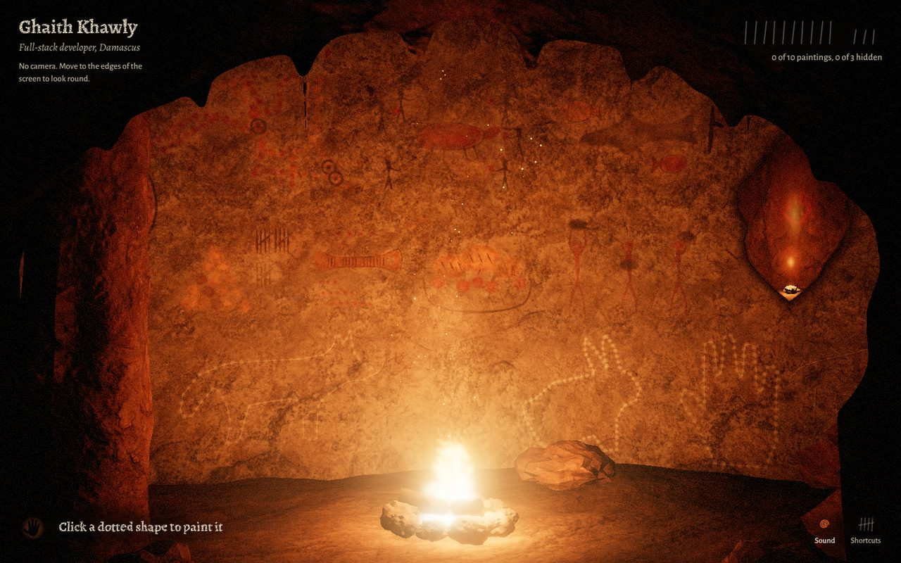
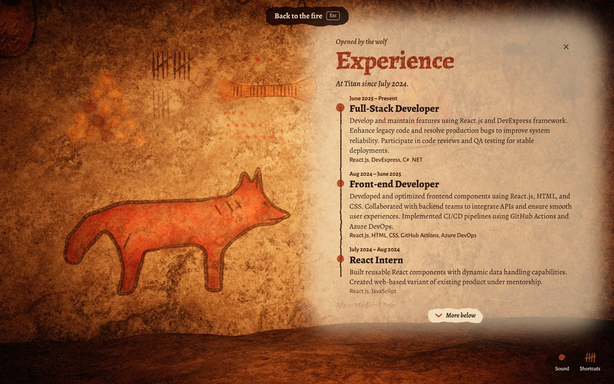
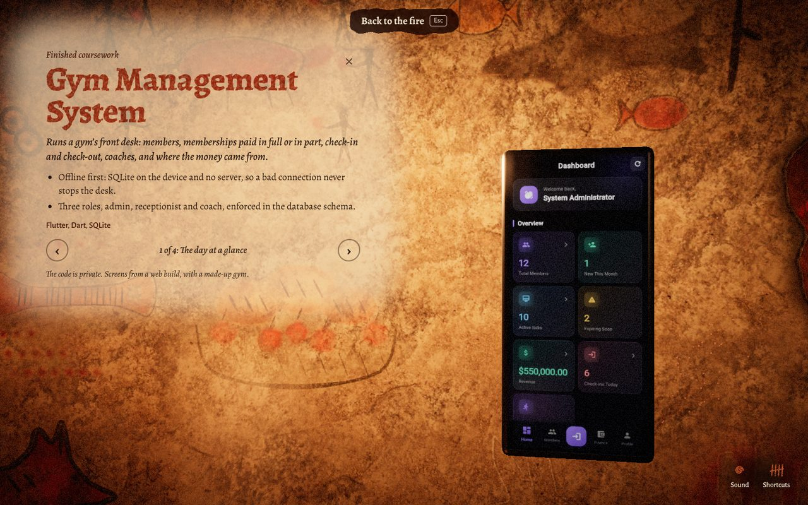
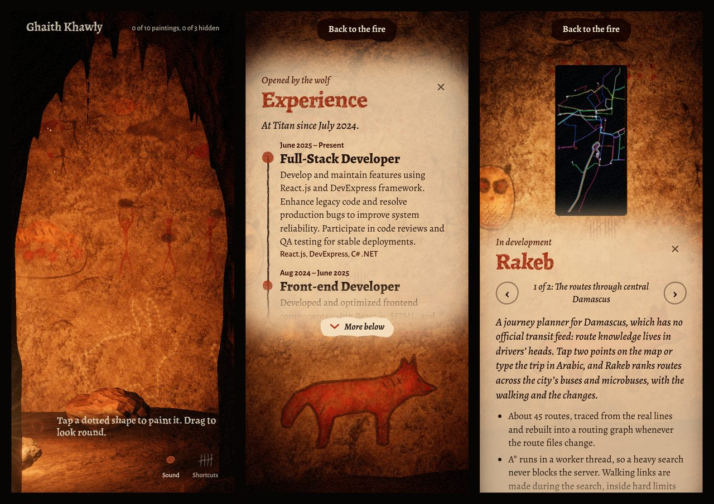
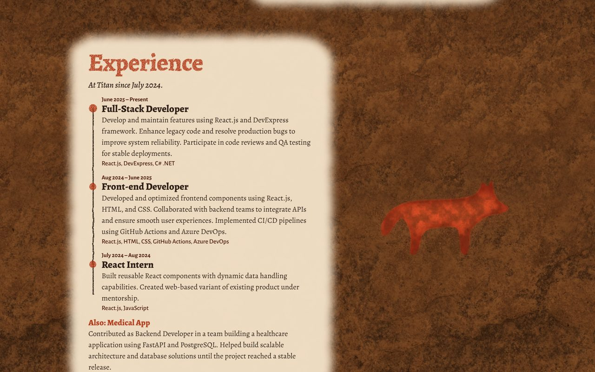

# ghaithkhawly.github.io

My portfolio: a firelit cave. With a webcam, your hands cast shadows on its wall and the
paintings answer; without one, you paint on it.



| A section, painted on the rock beside its painting | A project steps out of the wall as the device it runs on |
|---|---|
|  |  |

| On a phone | Where the cave can't be drawn: the same CV as a page |
|---|---|
|  |  |

Two sites live in this repo:

| | What | Path when deployed |
|---|---|---|
| [`apps/cave`](apps/cave) | **The Cave**: a firelit cave you explore with your hands and head (webcam) or by painting on the wall (mouse, touch). Vite + TypeScript + three.js. | `/` |
| [`apps/classic`](apps/classic) | The original React site, generated from my LaTeX CV. | `/classic/` |

Both read the same CV data: `apps/classic/src/data/*.json`, generated from
`apps/classic/cv-*.tex` (see the [classic README](apps/classic/README.md)).

The plan for The Cave's first release is in [`docs/v1-plan.md`](docs/v1-plan.md).
[`prototype/cave`](prototype/cave) is the single-file prototype it grew from, kept
as a reference.

## Run it

Node 22.

```bash
npm run setup     # install both apps
npm run dev       # the cave, with hot reload
npm run build     # both sites into dist/ (cave at /, classic at /classic/)
npm test          # the cave's browser checks (Playwright, Chromium)
```

The checks drive the real WebGL scene in a software renderer, so they are slow
(several minutes).

## Deploying

The [`Site` workflow](.github/workflows/site.yml) builds and checks both sites on
every push. On `main` it then commits `dist/` to the `gh-pages` branch, which
GitHub Pages serves. Rolling back is reverting that commit:
[docs/launch.md](docs/launch.md).
