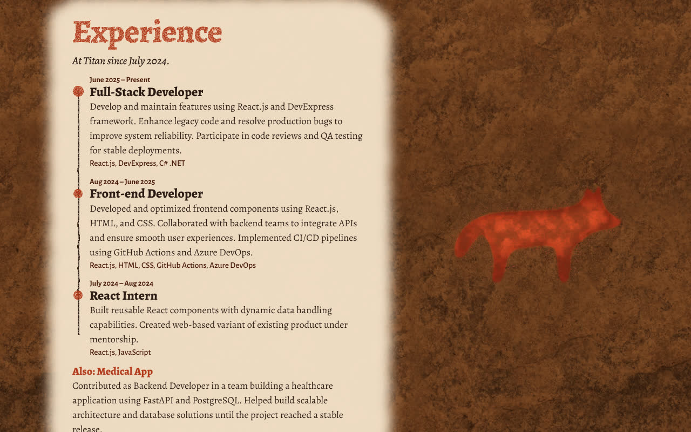
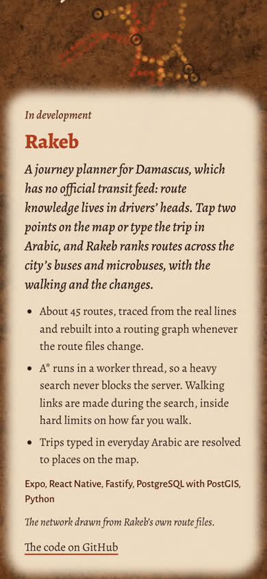

# M5: fallbacks and reach

M5 is done when every state of the site passes an accessibility audit, and the
whole cave works from a keyboard. Both now hold, and CI checks both on every
push.

| | Before M5 | Now |
|---|---|---|
| Lighthouse, the intro: accessibility, best practices, SEO | 100, 96, 82 | 100, 100, 100 |
| Lighthouse, the plain page | (didn't exist) | 100, 100, 100 |
| axe (WCAG 2.1 A and AA), every state | Not checked | No violations: intro, cave, shortcuts open, a section, a project, the plain page |
| A screen reader in the cave | The intro and the controls; a section only once something opened it | The whole CV, from the start |
| No WebGL 2, or no JavaScript | A broken page | The plain page |
| A keyboard in the cave | Could reach the shortcuts in painting mode only, and focus got lost | Reaches every section and project, camera or not, and focus follows |

## The CV as a plain page

| Computer | Phone |
|---|---|
|  |  |

The build writes the whole CV and every project into `index.html` as plain
HTML (`src/content/page.ts`), from the same content the cave reads, so the two
can't drift apart. That one copy does four jobs:

- **Screen readers** read it while the cave is up. It's in the accessibility
  tree but out of sight and out of the tab order, and none of its pictures
  load.
- **Search engines** index it.
- **Where the cave can't be drawn, it is the site**: no WebGL 2, no
  JavaScript, a WebGL context the browser takes back and doesn't return within
  a few seconds, or anyone who asks. A skip link (the first thing Tab reaches)
  and a line on the intro both lead to it (`?flat`).
- It's styled as the wall unrolled: each section's baked painting on lit rock,
  the words on a limewash beside it, and every project with its screens.

`main.ts` is now a small entry that marks the page `cave` and loads the 3D
scene (`cave.ts`) only where it can be drawn. That chunk is preloaded, so it
starts no later than before.

## Keyboard and focus

- **Shortcuts** shows in camera mode too. It's the keyboard's way to every
  section and project, and it's announced as a disclosure (expanded or
  collapsed).
- Starting the cave from the intro with a keyboard **lands on Shortcuts**.
- **Opening a section moves focus to its heading**, so a screen reader reads
  it.
- **Esc closes it**, and focus goes back to whatever opened it.
- The shapes list and the shortcuts sit in the same corner. Opening one closes
  the other.

## Reduced motion

With the system's "reduce motion" setting on:

- walking up to the wall is a cut;
- a painting finishes at once instead of being painted by the ghost hand;
- a project's device is simply there and holds still, and its screens don't
  move on by themselves;
- embers don't drift, and the fire flickers about a third as much.

Leaning with the head or the phone's tilt stays, since the visitor drives it.

## Share and search

The build writes all of these from the CV:

- the title and a description;
- the canonical address;
- Open Graph and Twitter tags, with a 1200×630 still of the cave
  (`public/og.jpg`);
- schema.org `Person` data.

The site also has:

- a hand-stencil favicon (SVG, plus PNGs for older browsers and iOS);
- `robots.txt` and `sitemap.xml`;
- a painted 404 page.

`npm run share-images` re-renders the still and the icons.

## Checks

| | Where |
|---|---|
| The plain page: shown where it should be, hidden where it shouldn't, takes over on a lost context | `tests/page.spec.ts` |
| A keyboard from the intro to a section and back, with reduced motion | `tests/keyboard.spec.ts` |
| axe on every state | `tests/a11y.spec.ts` |
