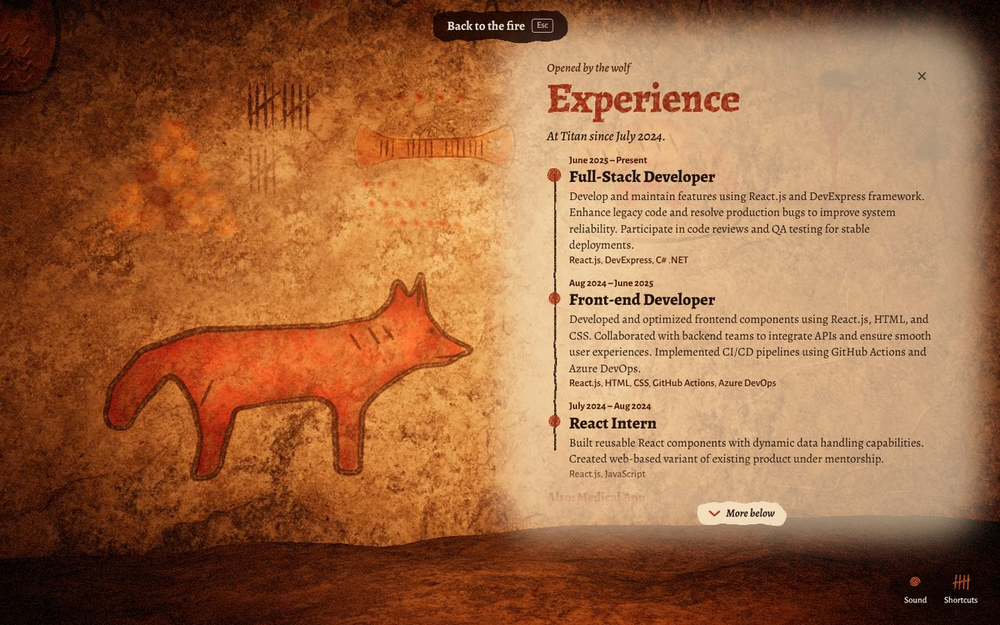
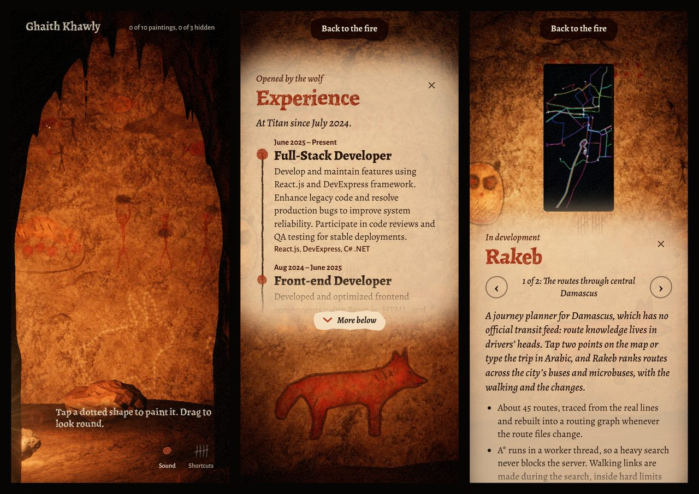

# Looking the whole site over

Before showing the site to anyone, every state of it was photographed and looked at:
the intro, the cave, the shortcuts, all six sections, all seven projects, camera mode
with its walkthrough, the plain page and the 404 page. Each at five sizes: a laptop
(1440×900), a small laptop (1366×650), a large monitor (1920×1080), a phone upright
(390×844) and on its side (844×390). `npm run frames` (in `apps/cave`) takes the same
pictures again.

| Computer | Phone |
|---|---|
|  |  |

## What was wrong, and what changed

| What the pictures showed | Now |
|---|---|
| A section's words were hard to read wherever they lay over other paintings | The limewash is two coats: a primer that covers what was painted there before, then the wash. Older figures show through faintly, like any wall painted twice |
| Sections away from the pointer sat in the dark, on a cold grey wash: the lamp followed the mouse, wherever it had been left | While a section is read, the lamp is held back and up, so the painting and the rock under the words are both lit |
| Long sections were cut off with only a fade to say so | The panel is taller, and where a section still doesn't fit, "More below" sits under it and reads on |
| The dotted shapes still to paint showed through the words | They step aside while a section is open |
| A project's phone was a third of the screen's height, too small to read; the laptop hung off the edge | Devices take a set share of the view (a phone 60% of its height) and always fit inside it |
| The shortcuts opened on top of the fire, white on white | They open beside their button, in the dark corner of the cave mouth, as two lists |
| "Back to the fire" could sit on a section's words | It has its own dab of soot, and on a short screen it moves to a corner |
| On a 1920×1080 monitor everything was small | Above 1700 px wide, type and controls are set a size up |
| A phone on its side: the intro's buttons were off-screen, the shortcuts covered the header | A compact layout for short, wide screens |
| On a phone: the name ran into the tally, a project's device faded into the words below it, the way through its screens was below the fold, and six tools wrapped onto the hint | Each fixed; the tally gives way to the count, and the screens' arrows come first |
| The plain page: on every other project the painting dropped below the screenshots; captions and the footer were dark on dark rock | Paintings stay beside their words; captions and footer are in kaolin |
| The intro said to touch "the phone or the laptop", which haven't been on the wall since the projects became paintings | "Point at a small painting" |
| The 404 page fell back to a system font | It has the site's font |

## Checked by tests now

- A stepped-out phone is over half the view's height, and wholly inside it.
- The laptop stays inside the view, and off the words.
- A section too long for its place shows "More below", and pressing it reads on.

## Still only checkable on real hardware

Frame rate on a phone (`?perf`), and the shapes with live hands (`?trial`). Everything
above was photographed in a software renderer, which draws the same picture slowly.
